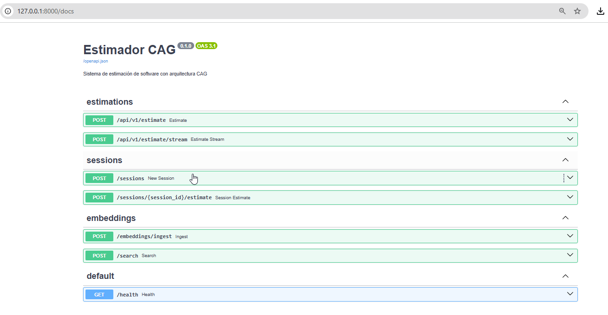
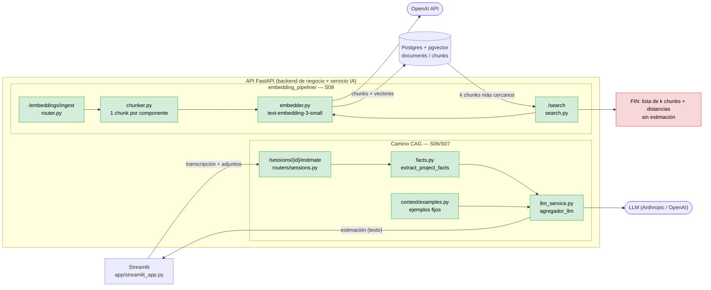
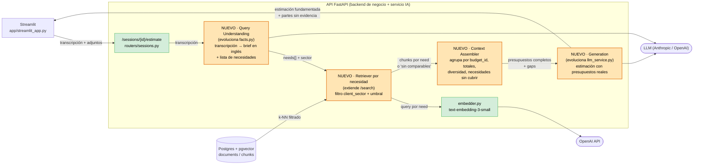

# Diagnóstico arquitectónico — Sesión 09 (pre-work)

> Plantilla del entregable. Rellena las cuatro secciones obligatorias y guarda el resultado como
> `arquitectura-actual.md` en la raíz del repositorio. Tus observaciones van en español; los
> comandos, payloads y nombres de campo van en inglés.
uv run uvicorn app.main:app --reload
uv run streamlit run app/streamlit_app.py

---

## 1. Diagrama de la arquitectura actual

> FRONTEND. 
Tenemos un fronend hecho en Streamlit que es lo de menos. Solo es para poder interacturar con la IA.
La parte importante es que se conecta por API al servicio de la IA, con lo que da lo mismo el frontend. Hemos cogido esa porque es lo más rápido y no es el foco. 

> BACKEND NEGOCIO
Está compuesto por la propia api que lleva los contratos de cada uno de los endpoints.




> SERVICIO IA

Es un sistema que hemos empezado con CAG, que inyecta a cada paso el texto al LLM. vistas las limitaciones en cuanto a que para pruebas piloto es ok pero no tiene capacidad de almacenamiento ni de tratar grandes volúmenes de datos, se decide migrar a un sistema RAG que almacena la información semántica , con los embeddings, y los campos adicionales para poder realizar las búsquedas. Esos campos adicionales nos ayudan a afinar mejor la búsqueda puesto que nos ayuda a tener la información catalogada.
La migración no está terminada ya que hoy conviven los dos mecanismos sin conexión. El CAG generar la estimación por sesión y RAG encuentra presupuestos, pero todavía no genera la estimación.

Para que el RAG funcione:
> Ha un servico de INGESTA, donde recogemos las entradas, en este caso de presupestos, catalogados, y los embebemos. Contienen las horas, las descripciones. etc. En el endpoint es el servicio de Post / embeddings / ingest. importante que el chunk es a nivel de linea de presupeusto y que se almacena de forma estructurada, no a texto corrido puesto que perdería eficacia.

> Search. Que llama a Busqueda semántica, y devuelve la búsqueda semántica por aproximación coseno. Hasta el momento, estamos devolviendo los k-chunks más cercanos. Cuando los Chunbks no son cercanos, se enviará un mensaje de Chunks no relevantes, para que la capa de negocio lo pueda tratar. A día de hoy, falta implementar este punto relevante.




---

## 2. Trace anotado de `02_ambiguous.txt`

> Trace manual a través del sistema tal como está. Para cada paso: la llamada ejecutada, la
> respuesta cruda y un comentario de una o dos frases.

### Paso 1 — Embeber la transcripción completa

=== Step 1: embed the full transcript ===
file: transcripts/02_ambiguous.txt
model: text-embedding-3-small
transcript_tokens: 890
dimension: 1536
norm: 1.000126
first_component: 0.00707244873046875
last_component: 0.020050048828125

**Comentario, un vector de 1536 dimensiones.

### Paso 2 — Búsqueda semántica (top-5)
```bash
curl -sS -X POST http://127.0.0.1:8000/search -H "Content-Type: application/json" \
  -d "$(python3 -c 'import json; print(json.dumps({"query": open("transcripts/02_ambiguous.txt").read(), "k": 5}))')"
```

_(comando + respuesta cruda con chunks y distancias)_

```json
{
  "query": "Reunión exploratoria — sin título claro todavía\nCliente: Rubén Castaño (gerente, Casa Castaño — tienda de productos gourmet)\nConsultor: equipo de estimación\nFecha: primera toma de contacto\n\n[00:00:08] Consultor: Buenas, Rubén. Cuéntame, ¿qué os ronda por la cabeza?\n\n[00:00:15] Rubén: Pues mira, es que llevamos dándole vueltas un tiempo y no sé muy bien por dónde\nempezar, por eso os hemos llamado. Tenemos la tienda física de toda la vida, la de mi padre, llevamos\ncon ella desde el noventa y dos. Conservas, vinos, aceite, esas cosas. Y claro, vemos que el mundo va\npor otro lado y que hay que dar el salto, pero no tenemos ni idea de tecnología, ¿eh?, te lo digo ya.\n\n[00:01:02] Consultor: Sin problema, para eso estamos. ¿Qué te gustaría conseguir?\n\n[00:01:09] Rubén: A ver, lo ideal sería vender por internet, eso seguro. Que la gente entre, vea los\nproductos y compre, ¿no? Pero también... mira, mi sobrina, que de esto sabe más que yo, me dice que\nlo importante hoy es fidelizar. Que un cliente que repite vale más que diez que vienen una vez. Y yo\npienso, pues igual algo de puntos, o un club, no sé, que la gente acumule y luego canjee. Eso me\ngustaría. Aunque tampoco quiero liarlo mucho al principio, ¿eh?\n\n[00:02:05] Consultor: Vale. ¿Y cómo te imaginas el día a día gestionándolo?\n\n[00:02:12] Rubén: Pues eso es lo otro. Yo necesito ver qué se vende. Un panel, algo donde yo entre\npor la mañana con el café y vea los pedidos del día, lo que más se mueve, el stock... que ahora lo\nllevo en un cuaderno, te lo juro. Mi mujer me dice que parezco del siglo pasado. Algo visual, con sus\ngráficas, para tomar decisiones. Eso lo veo clarísimo, lo del panel de control.\n\n[00:03:01] Rubén: Ah, y oye, una cosa importante: que la gente pueda pagar con tarjeta, claro. Eso es\nfundamental, que el pago sea fácil y seguro, que no se me vayan en el último paso. He oído que mucha\ngente llena el carrito y luego no paga, y eso no puede ser.\n\n[00:03:40] Consultor: Totalmente. ¿Tenéis volumen previsto, mercados, algo de eso?\n\n[00:03:47] Rubén: Uf, pues no sabría decirte. España de momento, supongo. Aunque un primo en Francia\nme dice que allí los productos españoles se venden solos, así que quién sabe, igual más adelante.\nPero no me hagas mucho caso con eso. Y mira, también pensaba... no sé si es mucho pedir, pero estaría\nbien mandar un correo cuando alguien compra, para que sepa que va su pedido. Detalles, ¿sabes? Que el\ncliente se sienta atendido como en la tienda de siempre.\n\n[00:04:35] Rubén: En fin, que tampoco quiero marearos. Que sé que esto es un mundo. Lo que necesito\nes que me digáis vosotros, que sois los que sabéis, qué se puede hacer y más o menos cuánto cuesta.\nYo de presupuestos de software ni idea, ¿eh? Decidme un número y vemos.\n\n[00:05:02] Consultor: Tranquilo, Rubén, lo recogemos y te volvemos con una propuesta. Gracias.",
  "k": 5,
  "search_time_ms": 1307,
  "results": [
    {
      "chunk_id": 18,
      "document_id": 8,
      "chunk_type": "component",
      "content": "[Project: Headless e-commerce storefront with personalized recommendations]\n[Client sector: ecommerce | Year: 2024 | Main tech: node]\n\nComponent: Product catalog API\\nDescription: GraphQL catalog API with faceted search, inventory availability and multi-currency pricing backed by Elasticsearch.\\nTech stack: node, graphql, elasticsearch\\nComplexity: medium\\nEstimated hours: 150.0",
      "distance": 0.6133963911450944,
      "metadata": {
        "year": 2024,
        "budget_id": "BUD-2024-005",
        "complexity": "medium",
        "component_id": "CATALOG-001",
        "client_sector": "ecommerce",
        "estimated_hours": 150.0,
        "main_technology": "node"
      }
    },
    {
      "chunk_id": 19,
      "document_id": 8,
      "chunk_type": "component",
      "content": "[Project: Headless e-commerce storefront with personalized recommendations]\n[Client sector: ecommerce | Year: 2024 | Main tech: node]\n\nComponent: Cart and checkout service\\nDescription: Stateless cart service with promotion engine, tax calculation and a checkout orchestration that integrates the payment provider.\\nTech stack: node, redis, postgresql\\nComplexity: high\\nEstimated hours: 140.0",
      "distance": 0.61801960726768,
      "metadata": {
        "year": 2024,
        "budget_id": "BUD-2024-005",
        "complexity": "high",
        "component_id": "CART-002",
        "client_sector": "ecommerce",
        "estimated_hours": 140.0,
        "main_technology": "node"
      }
    },
    {
      "chunk_id": 21,
      "document_id": 8,
      "chunk_type": "component",
      "content": "[Project: Headless e-commerce storefront with personalized recommendations]\n[Client sector: ecommerce | Year: 2024 | Main tech: node]\n\nComponent: Storefront PWA\\nDescription: Progressive web app storefront consuming the headless APIs with server-side rendering for SEO.\\nTech stack: next_js, react\\nComplexity: low\\nEstimated hours: 60.0",
      "distance": 0.6439138673493239,
      "metadata": {
        "year": 2024,
        "budget_id": "BUD-2024-005",
        "complexity": "low",
        "component_id": "STORE-004",
        "client_sector": "ecommerce",
        "estimated_hours": 60.0,
        "main_technology": "node"
      }
    },
    {
      "chunk_id": 20,
      "document_id": 8,
      "chunk_type": "component",
      "content": "[Project: Headless e-commerce storefront with personalized recommendations]\n[Client sector: ecommerce | Year: 2024 | Main tech: node]\n\nComponent: Personalized recommendations\\nDescription: Collaborative-filtering recommendations served from a feature store and exposed as a low-latency API for product and cart pages.\\nTech stack: node, redis\\nComplexity: medium\\nEstimated hours: 110.0",
      "distance": 0.6440111241381496,
      "metadata": {
        "year": 2024,
        "budget_id": "BUD-2024-005",
        "complexity": "medium",
        "component_id": "RECO-003",
        "client_sector": "ecommerce",
        "estimated_hours": 110.0,
        "main_technology": "node"
      }
    },
    {
      "chunk_id": 29,
      "document_id": 11,
      "chunk_type": "component",
      "content": "[Project: Fashion returns management and resale portal]\n[Client sector: ecommerce | Year: 2023 | Main tech: dotnet]\n\nComponent: Returns portal\\nDescription: Self-service returns portal with label generation, reason capture and automatic restock or resale routing.\\nTech stack: dotnet, sqlserver\\nComplexity: medium\\nEstimated hours: 140.0",
      "distance": 0.6471850014848488,
      "metadata": {
        "year": 2023,
        "budget_id": "BUD-2024-008",
        "complexity": "medium",
        "component_id": "RET-001",
        "client_sector": "ecommerce",
        "estimated_hours": 140.0,
        "main_technology": "dotnet"
      }
    }
  ]
}

 ```

Resumen de la respuesta:

| # | chunk_id | distance | budget_id | Proyecto | Componente |
|---|---|---|---|---|---|
| 1 | 18 | 0.6134 | BUD-2024-005 | Headless e-commerce storefront | Product catalog API |
| 2 | 19 | 0.6180 | BUD-2024-005 | Headless e-commerce storefront | Cart and checkout service |
| 3 | 21 | 0.6439 | BUD-2024-005 | Headless e-commerce storefront | Storefront PWA |
| 4 | 20 | 0.6440 | BUD-2024-005 | Headless e-commerce storefront | Personalized recommendations |
| 5 | 29 | 0.6472 | BUD-2024-008 | Fashion returns management | Returns portal |


**Las distancias son todas muy altas, lo que nos indica que no hay relevancia significativa, aunque las primeras habla de comerciio electrónico. Habría que devolver un "NO TENEMOS DATOS".
La transcripción de partida es ambigua y de hecho todo lo que menciona está delabazado: tienda online, pago con tarjeta, fidelización, contol de stock. Hace falta un filtro en la entrada que nos diga el contenido relevante según el objetivo que se persigue, de forma ordenada.**

### Paso 3 — Lectura de los chunks devueltos

| # | Presupuesto | Sector | ¿Relevante para Rubén? |
|---|---|---|---|
| 1 | BUD-2024-005 · Product catalog API (GraphQL + Elasticsearch, 150 h) | ecommerce | **Parcial.** Necesita un catálogo, pero no búsqueda facetada ni multidivisa: sobredimensionado para una tienda gourmet. |
| 2 | BUD-2024-005 · Cart and checkout service (140 h) | ecommerce | **Sí.** Carrito + checkout + pasarela de pago cubre "pagar con tarjeta" y "que no se vayan en el último paso". El mejor resultado. |
| 3 | BUD-2024-005 · Storefront PWA (60 h) | ecommerce | **Sí.** Es la tienda online que la gente "entra, ve y compra". |
| 4 | BUD-2024-005 · Personalized recommendations (110 h) | ecommerce | **No.** Rubén no pide recomendaciones. Entra porque es del mismo presupuesto que los anteriores y comparte cabecera de proyecto. |
| 5 | BUD-2024-008 · Returns portal (140 h) | ecommerce | **No.** Devoluciones de moda; Rubén no habla de devoluciones. |

**Lectura global:** 2 relevantes, 1 parcial y 2 irrelevantes. Cuatro de cinco vienen del mismo presupuesto, que es un ecommerce *headless* de alto nivel. Ninguno cubre la **fidelización** (no existe en el corpus), ni el **email de pedido** o el **panel de control**, que sí existen en `BUD-2024-017` pero quedan fuera. Con este top-5, una estimación saldría inflada: sumaría unas 460 h de componentes enterprise para lo que es un MVP.

## 3. Diagnóstico: cinco fallos identificados

```


```

Una de las opciones que siempre hay es aumentar K para ver el resto de resultados. No es una  solución de producción, pero sí que ayuda a ver fallos y a debug con más acierto.

 #  distance  budget_id      hours  component                            project
  1  0.6134    BUD-2024-005     150  Product catalog API                  Headless e-commerce storefront with personalized recommendations
  2  0.6180    BUD-2024-005     140  Cart and checkout service            Headless e-commerce storefront with personalized recommendations
  3  0.6439    BUD-2024-005      60  Storefront PWA                       Headless e-commerce storefront with personalized recommendations
  4  0.6440    BUD-2024-005     110  Personalized recommendations         Headless e-commerce storefront with personalized recommendations
  5  0.6472    BUD-2024-008     140  Returns portal                       Fashion returns management and resale portal
  6  0.6514    BUD-2024-007     120  Real-time inventory sync             Grocery delivery app with slot booking and route optimization
  7  0.6543    BUD-2024-017      28  Admin page                           Bare-bones e-commerce MVP scoped in one-line tickets
  8  0.6547    BUD-2024-017      40  Checkout                             Bare-bones e-commerce MVP scoped in one-line tickets
  9  0.6569    BUD-2024-017      20  Product list                         Bare-bones e-commerce MVP scoped in one-line tickets
 10  0.6582    BUD-2024-017      24  Cart                                 Bare-bones e-commerce MVP scoped in one-line tickets
 11  0.6696    BUD-2024-015     140  Load forecasting service             Energy grid monitoring and demand-response platform
 12  0.6698    BUD-2024-007     180  Route optimization service           Grocery delivery app with slot booking and route optimization
 13  0.6717    BUD-2024-007     120  Delivery slot booking                Grocery delivery app with slot booking and route optimization
 14  0.6720    BUD-2024-011     140  Inventory and reorder                Pharmacy inventory and prescription fulfillment system
 15  0.6748    BUD-2024-003      60  Merchant dashboard                   Real-time payments gateway with fraud detection and reconciliation
 16  0.6778    BUD-2024-014     220  Warehouse management core            Warehouse management system with automated guided vehicle coordination
 17  0.6792    BUD-2024-017      12  Order email                          Bare-bones e-commerce MVP scoped in one-line tickets
 18  0.6826    BUD-2024-016     520  Core banking ledger extraction and   Decomposition of a monolithic core banking platform into domain services
 19  0.6889    BUD-2024-017      16  Login page                           Bare-bones e-commerce MVP scoped in one-line tickets
 20  0.6908    BUD-2024-009     160  Telemedicine video sessions          Patient appointment and telemedicine platform with HL7/FHIR integration
 21  0.6908    BUD-2024-006     170  Split order management               Multi-vendor marketplace with vendor payouts and dispute handling
 22  0.6937    BUD-2024-014     240  AGV coordination service             Warehouse management system with automated guided vehicle coordination
 23  0.6956    BUD-2024-014     110  Yard and dock scheduling             Warehouse management system with automated guided vehicle coordination
 24  0.6971    BUD-2024-008     100  Item grading workflow                Fashion returns management and resale portal
 25  0.6982    BUD-2024-008      60  Resale listing sync                  Fashion returns management and resale portal
 26  0.6988    BUD-2024-014      50  Operations KPI reporting             Warehouse management system with automated guided vehicle coordination
 27  0.7022    BUD-2024-015     200  Smart meter data pipeline            Energy grid monitoring and demand-response platform
 28  0.7034    BUD-2024-006     100  Dispute and refund handling          Multi-vendor marketplace with vendor payouts and dispute handling
 29  0.7044    BUD-2024-004      80  Client onboarding and risk profilin  Robo-advisor portfolio rebalancing platform
 30  0.7063    BUD-2024-009     150  Appointment scheduling               Patient appointment and telemedicine platform with HL7/FHIR integration
 31  0.7077    BUD-2024-006     130  Vendor onboarding and KYC            Multi-vendor marketplace with vendor payouts and dispute handling
 32  0.7083    BUD-2024-011     170  Prescription intake and validation   Pharmacy inventory and prescription fulfillment system
 33  0.7088    BUD-2024-003     220  Payment gateway core                 Real-time payments gateway with fraud detection and reconciliation
 34  0.7092    BUD-2024-015     200  Demand-response engine               Energy grid monitoring and demand-response platform
 35  0.7146    BUD-2024-004     100  Market data ingestion                Robo-advisor portfolio rebalancing platform
 36  0.7153    BUD-2024-003     120  Settlement reconciliation            Real-time payments gateway with fraud detection and reconciliation
 37  0.7170    BUD-2024-002     180  Loan origination workflow            Automated loan origination platform with credit scoring and e-signature
 38  0.7178    BUD-2024-006     140  Vendor payouts engine                Multi-vendor marketplace with vendor payouts and dispute handling
 39  0.7190    BUD-2024-011      90  Dispensing and labeling              Pharmacy inventory and prescription fulfillment system
 40  0.7196    BUD-2024-004     160  Portfolio optimization service       Robo-advisor portfolio rebalancing platform
 41  0.7253    BUD-2024-002     200  Credit scoring engine                Automated loan origination platform with credit scoring and e-signature
 42  0.7293    BUD-2024-012     180  Electronic data capture forms        Clinical trial data capture and anonymization platform
 43  0.7303    BUD-2024-010     150  Care team dashboard                  Remote patient monitoring with wearable data ingestion and alerts
 44  0.7318    BUD-2024-013     170  Sensor telemetry ingestion           Factory IoT telemetry and predictive maintenance system
 45  0.7377    BUD-2024-013     130  SCADA dashboard integration          Factory IoT telemetry and predictive maintenance system
 46  0.7408    BUD-2024-003     200  Real-time fraud detection            Real-time payments gateway with fraud detection and reconciliation
 47  0.7427    BUD-2024-002      60  Regulatory reporting export          Automated loan origination platform with credit scoring and e-signature
 48  0.7446    BUD-2024-009      60  Consent and audit module             Patient appointment and telemedicine platform with HL7/FHIR integration
 49  0.7448    BUD-2024-002      80  E-signature integration              Automated loan origination platform with credit scoring and e-signature
 50  0.7488    BUD-2024-016     200  Anti-corruption layer to legacy cha  Decomposition of a monolithic core banking platform into domain services


> Cinco fallos concretos y verificables que impiden hoy convertir la transcripción en una
> estimación de calidad. Para cada uno: Problema observado / Causa probable / Propuesta de solución.

### Fallo 1 — La transcripción entera se usa como query
- **Problema observado:** la query son 890 tokens frente a chunks de ~100 tokens de media. Las distancias salen altas y comprimidas: solo 0.034 entre el 1.º (0.613) y el 5.º (0.647), y los 50 chunks del corpus caben entre 0.61 y 0.75. Todas son peores que la query *fuera de dominio* de la S08 ("mobile application for restaurant reservations", 0.57).
- **Causa probable:** no hay ninguna etapa entre la transcripción y `/search`. El embedding promedia las necesidades reales con todo el relleno (la tienda del padre, la sobrina, el primo de Francia, el café), y el vector resultante no apunta a nada concreto.
- **Propuesta de solución:** una etapa de comprensión previa a la búsqueda que extraiga de la transcripción solo lo relevante para estimar (qué quiere construir, sector, restricciones) y lo convierta en una especificación limpia, en el mismo idioma y registro técnico que el corpus.

### Fallo 2 — Cinco necesidades aplastadas en un solo vector
- **Problema observado:** Rubén pide cinco cosas (tienda online, fidelización por puntos, panel con stock, pago con tarjeta y email de pedido) y el top-5 solo cubre dos: catálogo/tienda y checkout. Las demás existen en el corpus pero quedan lejos: *Merchant dashboard* en el puesto 15, *Order email* en el 17, *Operations KPI reporting* en el 26.
- **Causa probable:** se hace una única búsqueda con un único vector. Un vector no puede estar cerca de cinco temas distintos a la vez: gana el tema dominante (ecommerce genérico) y el resto se pierde.
- **Propuesta de solución:** descomponer la petición en necesidades individuales y lanzar una búsqueda por cada una, combinando después los resultados.

### Fallo 3 — No hay umbral de relevancia ni aviso de "no tenemos datos"
- **Problema observado:** `/search` devuelve siempre k resultados, estén cerca o lejos. La fidelización por puntos no aparece en ninguno de los 60 chunks del corpus, y nada en la respuesta lo indica.
- **Causa probable:** el retriever ordena y corta por k, sin ningún criterio absoluto de relevancia ni ninguna comprobación de qué necesidades quedan cubiertas.
- **Propuesta de solución:** un umbral de distancia por debajo del cual el resultado no se considera evidencia, y una comprobación de cobertura por necesidad, que devuelva explícitamente "sin presupuestos comparables" para las partes no cubiertas, en lugar de dejar que la generación las invente.

### Fallo 4 — Un solo presupuesto copa el top-5, y es de otra escala
- **Problema observado:** 4 de los 5 resultados son del mismo presupuesto (`BUD-2024-005`, un ecommerce *headless* con GraphQL y Elasticsearch) y suman 460 h. El presupuesto que mejor encaja con una tienda pequeña, `BUD-2024-017` ("Bare-bones e-commerce MVP": product list, cart, checkout, order email, admin page), suma 140 h y queda entre los puestos 7 y 19. Una estimación basada en el top-5 saldría unas 3 veces inflada.
- **Causa probable:** todos los chunks de un presupuesto comparten la misma cabecera de proyecto, así que si uno se parece a la query, sus hermanos también. Además, los chunks de `BUD-2024-017` son muy pobres (60 tokens, descripciones de una línea como "Send receipt.") frente a las descripciones ricas de los presupuestos enterprise.
- **Propuesta de solución:** diversificar el resultado entre presupuestos distintos y tener en cuenta el tamaño o la complejidad del proyecto al elegir los comparables. A más largo plazo, enriquecer en la ingesta las descripciones demasiado escuetas.

### Fallo 5 — El flujo termina en chunks: nadie los convierte en una estimación
- **Problema observado:** la respuesta de `/search` es una lista de componentes sueltos con su distancia, sin totales por presupuesto ni ninguna estimación. El único camino que sí estima (CAG, `/sessions/{session_id}/estimate`) usa ejemplos fijos de `context/examples.py` y no consulta pgvector.
- **Causa probable:** los dos caminos (CAG de S06–S07 y RAG de S08) se construyeron por separado y no hay ninguna pieza que los una.
- **Propuesta de solución:** una pieza que agrupe los chunks recuperados por `budget_id` y los presente como presupuestos completos (con sus horas totales), y una etapa de generación que use ese contexto en lugar de los ejemplos fijos.

### Otros
- **Sin filtrado por metadata:** los chunks llevan `client_sector`, pero la búsqueda no lo usa. En el ranking se cuelan energía (puesto 11), farmacia (14), almacén (16) y banca (18) entre los chunks de `BUD-2024-017`.
- **Idioma y registro distintos:** transcripción en español coloquial frente a corpus en inglés técnico. Lo resolvería la misma etapa del Fallo 1.
- **Bug del chunker:** las líneas de componente siguen con `\\n` literales en lugar de saltos de línea (visible en el `content` del paso 2).
- **Sin índice vectorial (HNSW):** irrelevante con 60 chunks; necesario a escala.
- **Sesiones en memoria:** las sesiones del camino CAG se pierden al reiniciar la API.


## 4. Propuesta de evolución arquitectónica

Mismas tres capas que en la sección 1. En verde, lo que ya existe y se reutiliza; en **naranja, lo nuevo**. El camino de ingesta no cambia.



**Responsabilidades y flujo.** *Query Understanding* convierte la transcripción en un brief en inglés con la lista de necesidades y el sector (resuelve los Fallos 1 y 2, y el desajuste de idioma). El *Retriever por necesidad* lanza una búsqueda por cada necesidad, filtrada por `client_sector`, y descarta lo que supera el umbral: devuelve chunks por necesidad o "sin comparables" (Fallo 3). El *Context Assembler* agrupa los chunks por `budget_id`, añade las horas totales de cada presupuesto, evita que uno solo copie el contexto y lista las necesidades sin cubrir (Fallo 4). *Generation* recibe ese contexto en lugar de los ejemplos fijos y produce la estimación, indicando qué partes no tienen evidencia (Fallo 5). **La pieza más crítica es Query Understanding:** el trace muestra que el corpus sí contiene el presupuesto adecuado (`BUD-2024-017`), pero la query cruda no lo encuentra. Ninguna mejora posterior compensa una entrada mal formulada, y además parte de código que ya existe (`facts.py`).
